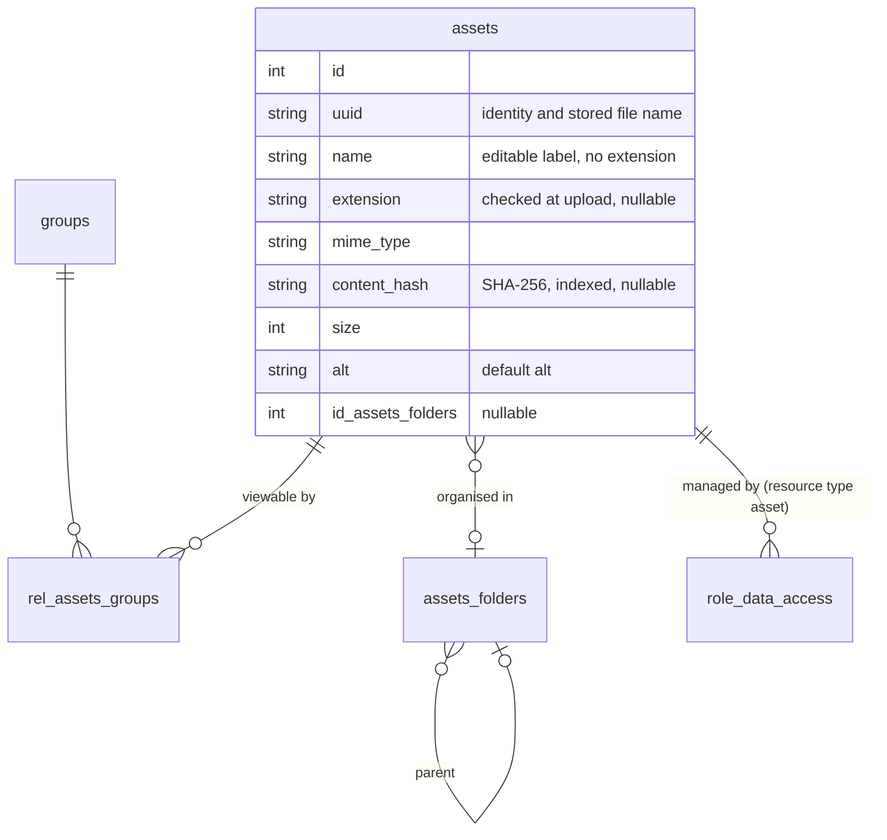

# Asset Management

Audience: Developers and technical operators.
Status: active.
Applies to: SelfHelp2 Symfony backend, core 0.1.43 and later.
Last verified: 2026-11-12.
Source of truth: `src/Entity/{Asset,AssetFolder}.php`, `src/Service/CMS/Admin/{AdminAssetService,AssetAccessService,AssetStorageService,AssetFileTypes,AssetFileSwap,AssetExportImportService,ActionAttachmentValidator}.php`, `src/Controller/Api/V1/{AssetController,Admin/AdminAssetController}.php`, migrations `Version20261103112133` and `Version20261112103337`, and the tests named below.

The endpoint-by-endpoint contract is in
[`docs/reference/api/06-admin-assets.md`](../reference/api/06-admin-assets.md).
This page explains how the pieces fit and the decisions behind them.

## Model

- **uuid is the identity and the file name.** The file is stored as
  `var/assets/<uuid>`, with no extension, so names never collide; there is no
  `file_name` column. `name` is an editable label without extension (the
  uploaded file name by default, searchable). The checked extension is stored
  in `extension` (see "Why the extension is stored"); downloads and email
  attachments are named `<name>-<uuid>.<extension>` (`AssetStorageService::
  downloadName()`, also the `file_name` of the asset object) and pickers show
  `name.<extension>`.
- **No overwrite.** Uploading a name that already exists creates a second
  asset. Changing bytes is an explicit edit (`updateAsset` with a file), which
  writes to the same uuid path, so every reference keeps working.
- **Folders only organise.** `assets_folders` is a tree (`id_parent`); an
  asset sits in at most one folder. Folders never decide access. Only an empty
  folder is deleted (see "Folder rules").

## Why the extension is stored (`AssetFileTypes`)

The stored file is named by its uuid and has no extension, and sniffing the
bytes cannot tell a CSV from plain text or a DOCX from a ZIP. So the
extension, checked against the allowlist `AssetFileTypes::ALLOWED_EXTENSIONS`,
is what gives the right MIME type (the canonical type of the extension: a CSV
is `text/csv`), the right download name and the right program. Two checks run
at upload and replace, in `AdminAssetService::validateUpload()`:

1. the extension is on the allowlist (`400` otherwise);
2. the bytes fit the extension: the file is sniffed with `finfo`
   (`UploadedFile::getMimeType()`) and the result must be one the extension
   may have (`AssetFileTypes::contentMatches()`; `400 The file content does not
   match its extension`). A script or HTML page named `x.png` is refused and
   leaves no row and no file. The sniff is a safety check, not the source of
   the type: text formats accept `text/plain`, Office and OpenDocument files
   accept the zip types (and `octet-stream` only when the bytes start with a zip
   signature), old Office files accept the OLE container.

Delivery shows images, audio, video, PDF and plain text inline and sends
everything else as an attachment (`AssetFileTypes::isInline()`). The sandboxing
CSP for SVG, HTML and XML is unchanged. Assets stored before the column existed
have `extension` NULL; their download name falls back to the extension of the
stored MIME type, and there is no backfill (the platform is unreleased).

## Folder rules (`AdminAssetService::saveFolder()`, `deleteFolder()`)

- A folder needs a name (`400` when empty or blank).
- A name is unique among siblings, compared case-insensitively (`409 A folder
  named 'X' already exists here`). It is checked in code, not by an index,
  because a unique index cannot cover a NULL parent (the top level). The same
  comparison is used by `ensureFolderPath()` when an import reuses folders.
- A folder cannot move into itself or one of its descendants (`400`).
- A folder nests at most `AdminAssetService::MAX_FOLDER_DEPTH` (20) levels deep,
  counting the subtree under a folder that is moved (`400`). The bundle import
  uses the same limit.
- Only an empty folder is deleted: a subfolder or any asset, **visible to the
  caller or not**, gives `409 The folder is not empty` and changes nothing. The
  FK is `RESTRICT`; there is no cascade.
- `GET /admin/asset-folders` returns `asset_count` (assets directly in the
  folder) and `subtree_asset_count` (in it and below), both only of assets the
  caller may manage. The tree and the counts are built in PHP from one folder
  query and one grouped asset count, so the number of queries does not grow
  with the tree (`AssetFolderTreeTest` counts them).

## Folder access (`AdminAssetService::setFolderAccess()`)

`POST /admin/asset-folders/{folderId}/access` applies who sees and/or who
manages to every asset in the folder and all its subfolders, **once**. Nothing
is stored on the folder: assets added later are not affected, so a folder still
decides no access. It is the bulk
pattern: the folder subtree is collected from one folder query, **every** asset
in it (not only those the caller can see) is checked with
`assertCanManage(UPDATE)` before the transaction opens (`403` and nothing
changed if one fails), then groups and/or roles are replaced and each asset is
touched in one transaction with one log line, and each asset's cache scope and
the asset lists are invalidated. `role_ids: []` follows the rule for an empty
role list (only an admin may send it).

## Duplicate warning

Upload and replace store the SHA-256 of the bytes in `content_hash`
(`recordFile()`). The upload response of `createAsset()` carries `duplicates`:
up to 5 other assets with the same hash that **the caller may manage**
(`{id, name, folder_id}`), so an editor is never told that a file they cannot
see exists. Nothing is refused. `duplicates` is added to the response after the
asset is built and is never part of a cached payload (a cached value holds only
what is the same for everybody).

## Access (`AssetAccessService`)

Two separate questions, two mechanisms:

| Question | Mechanism | Rule |
| --- | --- | --- |
| Who can **view** the file (website, app, delivery URL) | the asset's groups, `rel_assets_groups` | no groups = **public** (anonymous callers included); otherwise members of ANY of its groups; the admin role views everything |
| Who can **manage** it in the CMS (list, pickers, edit, delete, export) | `role_data_access`, resource type `asset`, CRUD bits | per asset, like data tables ([19-data-access-management.md](19-data-access-management.md)); the admin role manages everything |

- **The admin role is implicit.** It manages every asset without a grant, so
  its grant is never written (`AssetAccessService::withoutAdminRole()` drops
  it from every list of roles, found by name), never listed (`managingRoles()`
  skips it) and never offered as a default (`defaultManagingRoleIds()`).
  Migration `Version20261112103337` removed the grants older versions stored
  for it. Sending the admin role id in `role_ids` is accepted and stores
  nothing; a list that holds only the admin role counts as an empty list.
- New uploads are public and managed by the uploader's roles **that hold
  `admin.asset.create`** (full CRUD; the same rule as the creator's grants on a
  new page, finding F14), unless `group_ids` / `role_ids` say otherwise: an
  explicit `role_ids` list is taken as it is (minus the admin role). An empty
  one leaves the asset to the admin role alone, so only an admin may send it; for anyone else it is
  refused with `400` before anything changes, on upload and on edit, because
  the editor would lose the asset (finding F63).
- `canView()` reads the caller's groups with `UserRepository::getUserGroupIds()`
  by user id: the authenticated `User` from the token does not reliably carry
  its group collection.
- `assertCanManage()` goes through
  `DataAccessSecurityService::hasPermission()`, so every check is audited and
  the admin role short-circuits. Lists use `manageableAssetIdsOrNull()`
  (`RoleDataAccessRepository::getUserPermissionsForResources()`), and their
  cache key includes that scope, as do the image/video option lists of the
  section inspector. Those lists are added when the section is read
  (`SectionFieldService::withPickerOptions()`), never stored in the cached
  section payload: a payload cached by one editor would otherwise be served to
  an editor with a different grant. Covered by `SectionPickerOptionsTest`.
- `rightsFor()` answers "what may the CALLER do with each of these assets" for
  the CMS: `can_view` (same rule as `canView()`), `can_update`, `can_delete`
  (the grant bits). It makes one grants query and one groups query for the whole
  list and reads the grants directly, because `hasPermission()` writes an audit
  row per check. `AdminAssetService` adds the three flags **after** the cached
  list is read (`withCallerRights()`), so the shared list cache never holds an
  access answer; never move them into the cached payload. The frontend only
  draws from them (rule 1.1).
- `setManagingRoles()` replaces an asset's grants. It writes them through
  `AdminDataAccessService`, the one writer of `role_data_access`, so every
  insert and delete is logged as a `role_data_access` transaction and the
  touched roles' permission caches are dropped exactly as on the role screens;
  a grant that is already complete is not rewritten. `role_data_access` has no
  FK to the asset, so deleting an asset removes its grants first.
- Bulk actions are all-or-nothing. `bulk-delete`, `bulk-folder` and
  `bulk-groups` load every id (one unknown id = 404 and nothing happens) and
  check the caller's right on every asset **before** changing anything and
  before any transaction opens, so a refusal on the last id never leaves the
  first ones changed, and the refusal's audit row is kept (it is written in its
  own transaction and would be rolled back with an outer one).
- Route permissions still gate the actions (`admin.asset.read|create|update|delete`);
  `role_data_access` decides which assets they apply to.

## Storage and delivery (`AssetStorageService`, `AssetController`)

Files live outside the document root (`var/assets/`, parameter
`selfhelp.asset_storage_dir`; form uploads use `selfhelp.form_file_storage_dir`,
`var/form-files/`) so the web server can never serve them directly. Both folders
must persist: sh-manager mounts the `assets` and `form_files` volumes there, and
a non-Docker install must keep them across deploys. Tests use `var/test/`. `GET /assets/{uuid}` is the only way out: it checks
`canView()`, resolves the file with `resolveForDelivery()` (which refuses
anything that escapes the storage root, including symlinks), and sets
`Content-Type` from the stored MIME type and `Content-Disposition` naming the
file `<name>-<uuid>.<extension>` (`inline` for images, audio, video, PDF and
plain text, `attachment` for everything else). Markup types get a sandboxing CSP.

`uuidFromReference()` turns any stored reference — absolute or relative
delivery URL or the frontend BFF URL `/api/assets/<uuid>` — into the asset
uuid. Everything that reads an asset reference
from content goes through it.

**The file and its row change together or not at all** (`AssetStorageService`,
`AssetFileSwap`):

- *Upload / replace.* The new bytes are first staged as a hidden file next to
  their place (`.<uuid>.<random>.part`). The row, the grants and the log entry
  are written, and only then is the staged file renamed over the old one, as the
  very last step before the commit. The old bytes are kept as a hidden backup
  until the commit succeeded: if it fails, `AssetFileSwap::undo()` puts the old
  bytes back (or removes the file of an upload that never got a row); on
  success `keep()` drops the backup. A request that fails earlier leaves no
  staged file either. Covered by `AssetFileReplaceTest` (HTTP) and
  `AdminAssetCommitFailureTest` (a commit that fails on purpose).
- *Delete.* The rows, grants and log entries go in one transaction and the files
  only after it committed, so a failed commit leaves every row and every file;
  a file that cannot be removed afterwards is only an unreachable orphan.

## Default alt in page payloads

`PageService::withAssetDefaultAlts()` runs on the section tree of both draft and
published pages, **when the page is served**: after the page-level cache read
for a draft (`serveDraftVersion()` fills the cached payload's sections; the
cached page and the cached sections hold no alt that belongs to an asset) and
in `hydratePublishedPage()` for a published page. It collects every section
whose `img_src` is an asset and whose `alt` is empty, resolves them in **one**
query (`AssetRepository::findByUuids()`), and fills `alt` from the asset. A
section's own alt always wins. Because the alt is read per request, editing an
asset's alt shows on every page at once and needs **no cache flush**
(`PageImageAltFallbackTest` changes the alt behind the cache's back to prove
it). The image style's Alt help text explains this.

## Email attachments

Action configs store an attachment as the asset's delivery URL. **Assets
only**: a raw server path, an external URL or a reference to anything else is
refused. `ActionAttachmentValidator` checks every attachment when the action is
saved (create and update): the asset must exist (400) and the person saving the
action must be allowed to view it (403; admin may attach any), and nothing is
stored on a refusal. `JobSchedulerService` repeats the rule when the mail is
built (`resolveAssetAttachment()`): only assets resolve, a stored server path is
skipped with a warning, and the file is attached under its download name
`<name>-<uuid>.<extension>`. The
view right is checked at save time only, not again at send time. Covered by
`ActionAttachmentAccessTest` and `JobSchedulerServiceTest`.

## Export / import (`AssetExportImportService`)

Bundle `selfhelp/asset-bundle` 2.0: `manifest.json` plus
`files/<name>-<uuid>.<ext>` (the download name, so an unpacked bundle opens in
the right program; the manifest's `bundle_path` names each file and the importer
reads by it). Entries carry uuid, name, alt, MIME type, `extension` (an older
bundle without it takes the extension of its MIME type), group **names** and the **folder path** as a
list of folder names from the top level down (`"folder_path": ["Courses",
"Week 1"]`; ids differ between instances, so only names travel). The managing
roles do not travel: the importer's roles that may create assets manage what
they import, like a normal upload. Export covers only assets the caller may
manage.

Import never overwrites — an existing uuid is skipped — and otherwise recreates
the asset under the same uuid. Folders are recreated by name where they do not
exist and **reused** where they do (`AdminAssetService::ensureFolderPath()`);
`folder_path` is optional (absent, `null` or `[]` = the top level), so a bundle
made before it existed still imports, and a `folder_path` that is not a list of
at most 20 non-empty names refuses that entry (`Invalid folder path`). An entry that names a group
this instance does not have is **not imported** and appears in the result's
`errors` (`Unknown group name(s): ...`): silently dropping the group would turn a
restricted asset public (no groups = public). Other bundle versions are
rejected.

An uploaded bundle is **untrusted**:

- It is read entry by entry (`ZipArchive::getStream`) and never extracted as a
  whole, so a file the manifest does not name is never written, and an entry
  name like `../x` has nowhere to go. Every manifest `bundle_path` must be
  exactly `files/<name>` (`Invalid bundle path` otherwise).
- The bytes of each file are counted as they are read, not taken from the sizes
  the archive declares, and the import stops at the limits below. Export adds
  the stored files to the archive by path (nothing is loaded into memory) and
  obeys the same count and total size, so an export can always be imported
  again; one that is too big is refused (400) before an archive is started.
- Every work file is removed again, also when the import fails
  (`AssetBundleTest` checks the temporary directory), and the export archive is
  a `BinaryFileResponse` that deletes itself after it is sent.

| Limit | Value | When exceeded |
| --- | --- | --- |
| assets (manifest entries; the archive may hold at most this + 1 entries) | 2000 | 400, no asset is imported |
| `manifest.json` | 8 MB | 400 |
| one file | 512 MB | that entry is reported in `errors`, the others still import |
| files in total | 4 GB | the import stops where it is crossed and keeps what came before; the entry is reported |

The limits are class constants (`AssetExportImportService::MAX_*`) and
constructor arguments, so tests (`AssetExportImportLimitsTest`) can lower them.

## Migration

`Version20261103112133` goes straight from the baseline `assets` table to this
model (the platform is unreleased, so there is no data backfill):

1. Drops the `admin` and `therapist` groups (and the `role_data_access` rows
   that pointed at them): admin rights come from the admin role, and `subject`
   is the one built-in group, flagged `add_to_new_pages`. Memberships and page
   and asset ACL rows of a removed group go with it (FK cascade).
2. Creates the `assets_folders` tree and `rel_assets_groups`.
3. Replaces `folder`, `file_name` and `file_path` on `assets` with `uuid`,
   `name`, `mime_type`, `size`, `alt`, timestamps and `id_assets_folders`.
4. Adds the `asset` resource type, the `admin.asset.update` permission (granted
   to every role that can upload) and the asset routes (edit, bulk groups, bulk
   move, bulk delete, export, import, folder CRUD and uuid delivery).
5. Titles the image style's fields (Image Source, Alt, Title, Fluid) and
   explains the alt fallback.

`Version20261112103337` (generated) adds `assets.extension` and
`assets.content_hash` with its index, makes the `assets_folders.id_parent` FK
`RESTRICT`, adds the route `POST /admin/asset-folders/{folderId}/access`
(permission `admin.asset.update`) and deletes the `role_data_access` rows of the
admin role on assets. `down()` reverses the schema and the route; the admin
grants are not restored, which is harmless because the admin role short-circuits.
Existing assets keep a NULL extension and hash.

## Tests

| Test | Covers |
| --- | --- |
| `tests/Controller/Api/V1/AdminAssetControllerTest.php` | upload under uuid (public, managed by the uploader), explicit groups, no overwrite, edit, replace keeps uuid, bulk groups, bulk move, bulk delete, folders (nest, filter, no self-nesting, delete only when empty, top level `folder_id=0`, `asset_count`), export/import round trip, import refuses an asset naming a group that does not exist here |
| `tests/Controller/Api/V1/Admin/AssetManagementAccessTest.php` | two editors: an upload is managed only by the uploader's role until shared; the admin role manages all; the `can_view` / `can_update` / `can_delete` flags match what the server then accepts or refuses |
| `tests/Controller/Api/V1/Admin/AssetManagingRolesTest.php` | default managing roles (the uploader's roles that hold `admin.asset.create`), explicit and empty `role_ids`, grants logged as `role_data_access` transactions, bulk delete / move / groups all-or-nothing with the refusal audit kept |
| `tests/Controller/Api/V1/Admin/AssetFileReplaceTest.php` | a replace swaps the bytes under the same uuid and leaves no hidden work file, also when it is refused or fails |
| `tests/Unit/Service/CMS/Admin/AssetStorageSwapTest.php` | stage, swap in, keep and undo of a file on its own: old bytes preserved, backups and staged files cleaned up |
| `tests/Service/CMS/Admin/AdminAssetCommitFailureTest.php` | a commit that fails on purpose: create, edit and delete leave the rows and the files exactly as before |
| `tests/Controller/Api/V1/Admin/AssetBundleTest.php` | bundle round trip with `folder_path`, folder reuse, old bundles, invalid or hostile paths, entries the manifest does not name, entry / manifest limits, no temporary file left |
| `tests/Service/CMS/Admin/AssetExportImportLimitsTest.php` | export and import caps (count, one file, total bytes), with small caps injected |
| `tests/Controller/Api/V1/Admin/ActionAttachmentAccessTest.php` | email attachments: assets only, the author must be allowed to view the asset, nothing stored on a refusal |
| `tests/Unit/Service/CMS/Admin/AssetAccessRightsTest.php` | the `can_*` decision alone: admin, public asset, group membership, update/delete bits per asset |
| `tests/Controller/Api/V1/Admin/SectionPickerOptionsTest.php` | the image picker lists only the assets the caller manages, whoever opened the section first |
| `tests/Controller/Api/V1/AssetDeliveryAclTest.php` | view matrix (no groups = public, group members, admin role), unknown uuid, SVG sandbox |
| `tests/Controller/Api/V1/Admin/AdminAssetPermissionTest.php` | route permission matrix incl. bulk move, bulk delete and folder routes |
| `tests/Controller/Api/V1/Frontend/PageImageAltFallbackTest.php` | default alt fallback in the page payload |
| `tests/Service/Core/JobSchedulerServiceTest.php` | asset URL attachments are attached |
| `tests/Integration/Migrations/Version20261103112133RoundTripTest.php` | migration up/down/up (migration tier) |
| `tests/Integration/Migrations/Version20261112103337RoundTripTest.php` | the same for the extension / hash / folder RESTRICT / access route migration |
| `tests/Controller/Api/V1/Admin/AssetFileTypeTest.php` | CSV, Office files and images keep their type and download name; inline vs attachment; a script or HTML named `.png`, a wrong extension and a disallowed extension are refused and leave no row and no file |
| `tests/Controller/Api/V1/Admin/AssetDuplicateTest.php` | the same bytes twice report the first asset; an identical asset the caller may not manage is not listed |
| `tests/Controller/Api/V1/Admin/AssetFolderTreeTest.php` | sibling names (any case), empty name, depth 20, delete only when empty (also with an asset the caller cannot see), moves, `subtree_asset_count`, constant query count |
| `tests/Controller/Api/V1/Admin/AssetFolderAccessTest.php` | folder access: groups, roles, public, subtree only, all-or-nothing 403, empty role list, input errors, unknown folder |
| `tests/Support/AssetFixtures.php`, `tests/Support/InteractsWithAssetApi.php` | real file bytes for uploads (a `.png` must be a PNG) and small helpers for the asset API |
