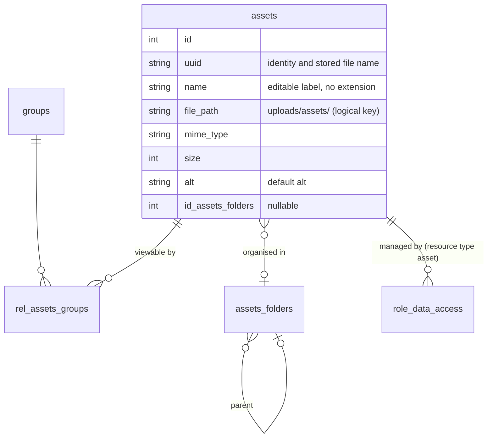

# Asset Management

Audience: Developers and technical operators.
Status: active.
Applies to: SelfHelp2 Symfony backend, core 0.1.43 and later.
Last verified: 2026-11-04.
Source of truth: `src/Entity/{Asset,AssetFolder}.php`, `src/Service/CMS/Admin/{AdminAssetService,AssetAccessService,AssetStorageService,AssetExportImportService}.php`, `src/Controller/Api/V1/{AssetController,Admin/AdminAssetController}.php`, migration `Version20261103112133`, and the tests named below.

The endpoint-by-endpoint contract is in
[`docs/reference/api/06-admin-assets.md`](../reference/api/06-admin-assets.md).
This page explains how the pieces fit and the decisions behind them.

## Model

- **uuid is the identity and the file name.** The file is stored as
  `var/assets/<uuid>`, with no extension, so names never collide; there is no
  `file_name` column. `name` is an editable label without extension (the
  uploaded file name by default, searchable). The type comes from the stored
  MIME type; downloads and email attachments are named
  `<uuid>.<extension of the MIME type>` and pickers show `name.<extension>`.
- **No overwrite.** Uploading a name that already exists creates a second
  asset. Changing bytes is an explicit edit (`updateAsset` with a file), which
  writes to the same uuid path, so every reference keeps working.
- **Folders only organise.** `assets_folders` is a tree (`id_parent`); an
  asset sits in at most one folder. Folders never decide access. Deleting a
  folder deletes its subfolders (FK cascade) and moves their assets to the top
  level (`ON DELETE SET NULL`).

## Access (`AssetAccessService`)

Two separate questions, two mechanisms:

| Question | Mechanism | Rule |
| --- | --- | --- |
| Who can **view** the file (website, app, delivery URL) | the asset's groups, `rel_assets_groups` | no groups = **public** (anonymous callers included); otherwise members of ANY of its groups; the admin role views everything |
| Who can **manage** it in the CMS (list, pickers, edit, delete, export) | `role_data_access`, resource type `asset`, CRUD bits | per asset, like data tables ([19-data-access-management.md](19-data-access-management.md)); the admin role manages everything |

- New uploads are public and managed by the uploader's roles (full CRUD),
  unless `group_ids` / `role_ids` say otherwise. The upload form says so in
  large letters.
- `canView()` reads the caller's groups with `UserRepository::getUserGroupIds()`
  by user id: the authenticated `User` from the token does not reliably carry
  its group collection.
- `assertCanManage()` goes through
  `DataAccessSecurityService::hasPermission()`, so every check is audited and
  the admin role short-circuits. Lists use `manageableAssetIdsOrNull()`
  (`RoleDataAccessRepository::getUserPermissionsForResources()`), and their
  cache key includes that scope, as do the section image/video pickers.
- `setManagingRoles()` replaces an asset's grants and invalidates the touched
  roles' permission caches. `role_data_access` has no FK to the asset, so
  deleting an asset removes its grants first.
- Route permissions still gate the actions (`admin.asset.read|create|update|delete`);
  `role_data_access` decides which assets they apply to.

## Storage and delivery (`AssetStorageService`, `AssetController`)

Files live outside the document root (`var/assets/`) so the web server can never
serve them directly. `GET /assets/{uuid}` is the only way out: it checks
`canView()`, resolves the file with `resolveForDelivery()` (which refuses
anything that escapes the storage root, including symlinks), and sets
`Content-Type` from the stored MIME type. Markup types get a sandboxing CSP.

`uuidFromReference()` turns any stored reference — absolute or relative
delivery URL, the frontend BFF URL `/api/assets/<uuid>`, or a logical
`file_path` — into the asset uuid. Everything that reads an asset reference
from content goes through it.

## Default alt in page payloads

`PageService::withAssetDefaultAlts()` runs on the section tree of both draft
(cached) and published (hydrated per request) pages. It collects every section
whose `img_src` is an asset and whose `alt` is empty, resolves them in **one**
query (`AssetRepository::findByUuids()`), and fills `alt` from the asset. A
section's own alt always wins. Editing an asset's alt invalidates the sections
cache so draft pages update too. The image style's Alt help text explains this.

## Email attachments

Action configs store an attachment as the asset's delivery URL.
`JobSchedulerService` resolves it with `uuidFromReference()` to the stored file
and attaches it as `<uuid>.<extension>`.

## Export / import (`AssetExportImportService`)

Bundle `selfhelp/asset-bundle` 2.0: `manifest.json` plus `files/<uuid>`. Entries
carry uuid, name, alt, MIME type and group **names** (ids differ between
instances). Export covers only assets the caller may manage. Import never
overwrites — an existing uuid is skipped — and otherwise recreates the asset
under the same uuid, managed by the importer's roles. Version 1.0 (folder)
bundles still import, as public assets.

## Migration from the folder model

`Version20261103112133`, in order:

1. Renames the `therapist` group to `researcher` (creates it when missing).
2. Adds `uuid`, `name` (the old file name without extension), `mime_type`,
   `size`, `alt`, timestamps and `id_assets_folders`.
3. Adds the `asset` resource type and grants every existing asset to the roles
   that hold `admin.asset.read`.
4. Viewing: assets in open-access folders stay public (no groups); assets in
   closed folders get the folder's groups, or `researcher` when it had none.
5. Keeps `assets_folders` as the organisation tree (drops its grants, the
   open-access flag and the access-level lookups) and links each asset to its
   folder; drops `file_name` and `folder`.
6. Swaps the folder/ACL routes for edit, bulk groups, bulk delete, folder CRUD
   and uuid delivery, and adds `admin.asset.update`.
7. Titles the image style's fields (Image Source, Alt, Title, Fluid) and
   explains the alt fallback.
8. Drops the `admin` group — admin rights come from the admin role, which
   bypasses page ACLs — after moving assets it alone guarded to `researcher`.
   Its memberships, page ACL rows and validation codes go with it (cascade).

This is a new system, so the migration deliberately does **not** rewrite
folder-era URLs in content (`/cms-api/v1/assets/<folder>/<file>`) or move
files: those URLs stop working, and such content must re-pick its asset.
Existing rows keep their `file_path`, so a file still on disk at
`var/assets/<folder>/<name>` is served under the new uuid URL, without a
recorded MIME type.

`down()` is best effort: folders come back flat with grants rebuilt from the
asset groups, `file_name` from `file_path`, the `admin` group without its
memberships or ACL rows, and `researcher` becomes `therapist` again.

## Tests

| Test | Covers |
| --- | --- |
| `tests/Controller/Api/V1/AdminAssetControllerTest.php` | upload under uuid (public, managed by the uploader), explicit groups, no overwrite, edit, replace keeps uuid, bulk groups, bulk delete, folders (nest, filter, no self-nesting, delete, top level `folder_id=0`, `asset_count`), export/import round trip |
| `tests/Controller/Api/V1/Admin/AssetManagementAccessTest.php` | two researchers: an upload is managed only by the uploader's role until shared; the admin role manages all |
| `tests/Controller/Api/V1/AssetDeliveryAclTest.php` | view matrix (no groups = public, group members, admin role), unknown uuid, SVG sandbox |
| `tests/Controller/Api/V1/Admin/AdminAssetPermissionTest.php` | route permission matrix incl. bulk delete and folder routes |
| `tests/Controller/Api/V1/Frontend/PageImageAltFallbackTest.php` | default alt fallback in the page payload |
| `tests/Service/Core/JobSchedulerServiceTest.php` | asset URL attachments are attached |
| `tests/Integration/Migrations/Version20261103112133RoundTripTest.php` | migration up/down/up (migration tier) |
